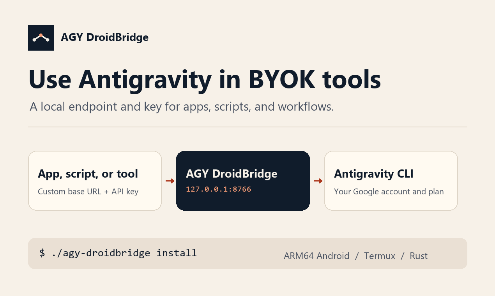

# AGY DroidBridge



**Use your Antigravity plan in BYOK apps and tools.**

When a tool asks you to bring your own key (BYOK), give it DroidBridge's local URL and the key created during setup. DroidBridge runs in Termux on Android and sends text requests to `agy`. The Antigravity CLI handles Google sign-in and model usage.

## Use the allowance you already have

DroidBridge uses your signed-in account's existing Antigravity allowance. For requests that fit within that allowance, you can skip a separate metered API bill. A paid Google AI plan can also work out cheaper if its price is below your usual API spend and its included usage covers your workload. Models, quotas, and any credit overages depend on your account. [Antigravity plans and overages](https://antigravity.google/docs/plans)

**Already claimed Google AI Pro through Jio?** Sign in to Antigravity with the Google account you used to redeem it. Jio says its offer is closed to new claims. Eligible users who already redeemed it can retain up to 18 months under the offer terms. Google lists different Antigravity limits for promotional and paid plans. [Jio offer terms](https://www.jio.com/jcms/en-in/jio-google-gemini-terms-and-conditions/) · [Antigravity plan limits](https://antigravity.google/docs/plans#baseline-quota)

## Get started

Use an ARM64 Android phone with Termux and a working Antigravity CLI. In Termux, `uname -m` should print `aarch64` and `agy --version` should show a recent CLI version. Run `agy models` once and finish Google sign-in if prompted.

```sh
pkg install git
git clone https://github.com/paritoshpky5/agy-droidbridge.git
cd agy-droidbridge
./agy-droidbridge install
```

The installer builds the server and creates your private API key. Allow a few minutes for the first build. If setup reports that the text agent has not loaded, run the following once. Approve the DroidBridge folder in Antigravity and exit it before running the second command.

```sh
./agy-droidbridge trust
./agy-droidbridge start
```

## Connect a BYOK client

Use an app, script, or tool that accepts **both a custom base URL and an API key**. Requests need to come directly from the same Android device. Select the provider format the client supports.

| Provider format | Custom base URL | Text API |
| --- | --- | --- |
| OpenAI-compatible | `http://127.0.0.1:8766/v1` | Chat Completions and model listing |
| Anthropic-compatible | `http://127.0.0.1:8766` | Messages |

For the key or token field, use the contents of `~/.local/share/agy-droidbridge/api-key`. That key authenticates the client to DroidBridge. Your Google credentials stay with the Antigravity CLI. If the tool asks for a model, run `./agy-droidbridge models` and pick an ID from the refreshed list.

`./agy-droidbridge status` checks the running server. Use `./agy-droidbridge stop`, `start`, or `restart` to manage it. See the [setup guide](docs/setup.md) for a first request with curl, model refresh, and troubleshooting.

Use a text workflow that calls one of the supported endpoints. OpenAI streaming clients receive buffered chunks after generation completes.

## What has been tested

The HTTP contract and the official OpenAI JavaScript SDK have been exercised with a mock CLI. An Android 14 emulator app reached the bridge over localhost and repeated the check after a restart. A physical ARM64 Termux run with an authenticated Antigravity session is still pending. See the [test report](TEST_REPORT.md).

If you try it, [open an issue](https://github.com/paritoshpky5/agy-droidbridge/issues) with your Android version, Android architecture, `agy --version`, and the step you reached. Keep API keys and account details out of reports.

Built by [Paritosh](https://github.com/paritoshpky5).
